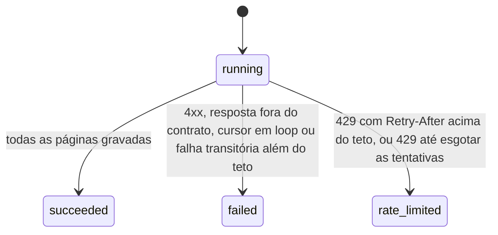

# Métricas das redes do criador

Serviço que recebe uma conexão já autorizada com Instagram, TikTok, YouTube ou X (o token pode ser fictício) e sincroniza views, curtidas e comentários dos posts. Ele aguenta timeout, resposta duplicada e limite de taxa do provedor. Duas sincronizações com janelas sobrepostas não contam o mesmo post duas vezes.

O provedor é simulado: um app Hono separado em `src/fake-provider/`, que fala HTTP e pode responder com timeout, 5xx, 429 com `Retry-After`, itens duplicados, posts repetidos entre páginas e cursor em loop.

## Como rodar

Precisa de Node 22 ou mais novo. O teste de carga também precisa de Docker.

```bash
npm install
npm run provider   # terminal 1: provedor simulado em http://localhost:3010
npm run dev        # terminal 2: API em http://localhost:3000 (banco em data/metrics.sqlite)
npm test           # unitários + integração (sqlite em memória, relógio controlado)
npm run typecheck
npm run load       # sobe provedor (3112) e API (3102), roda k6 no Docker e verifica as invariantes
```

Configuração da API por variável de ambiente:

| Variável | Padrão | O que faz |
|---|---|---|
| `PORT` | 3000 | porta da API |
| `DB_PATH` | `data/metrics.sqlite` | arquivo do sqlite |
| `PROVIDER_BASE_URL` | `http://localhost:3010` | onde está o provedor |
| `PROVIDER_TIMEOUT_MS` | 5000 | timeout de cada chamada (AbortController) |
| `SYNC_MAX_ATTEMPTS` | 5 | teto de tentativas por página, contando a primeira |
| `SYNC_BACKOFF_BASE_MS` / `SYNC_BACKOFF_MAX_MS` | 500 / 8000 | backoff exponencial das falhas transitórias |
| `SYNC_MAX_RETRY_AFTER_MS` | 30000 | maior `Retry-After` que o sync aceita esperar |
| `SYNC_MAX_PAGES` | 100 | proteção contra paginação sem fim |

## Onde fica cada coisa

```
src/
  app.ts                 rotas HTTP, validação e mapeamento de erro
  sync-service.ts        regra do sync: paginação, retry, 429, gravação idempotente
  domain/retry.ts        funções puras: backoff, parse do Retry-After, decisão de repetir
  domain/window.ts       validação da janela {since, until}
  provider/types.ts      contrato ProviderClient (a fronteira)
  provider/http-client.ts implementação HTTP do contrato: timeout, classificação de status, parse
  fake-provider/         provedor simulado (app Hono separado) e dados determinísticos
  db.ts                  schema e todo o SQL
  clock.ts               Clock, Sleep e ManualClock para testes
```

A fronteira entre o provedor falso e a regra de negócio é a interface `ProviderClient` em `src/provider/types.ts`. O `SyncService` só conhece esse contrato. O `HttpProviderClient` faz a chamada e devolve um de quatro resultados: `ok`, `transient` (timeout, erro de rede, 5xx, 408), `rate_limited` (429, com o header `Retry-After` cru) ou `permanent` (outros 4xx, JSON fora do contrato). Ele não repete nada. Quem decide se repete, quanto espera e quando desiste é o `SyncService`, usando as funções puras de `domain/retry.ts`.

O provedor simulado não é importado pela API. Nos testes de integração, o cliente HTTP real recebe um `fetch` que aponta para `providerApp.request(...)`. Assim o caminho todo (URL, headers, status, JSON, timeout) é exercitado sem abrir porta. No `npm run dev` e no teste de carga ele roda como servidor separado.

## Modelo de dados

```
connections       (id, creator_id, platform, external_account_id, access_token, rate_limited_until)
                  UNIQUE (platform, external_account_id)
posts             (connection_id, external_post_id) PK, published_at, caption,
                  first_fetched_at, last_fetched_at
metric_snapshots  (connection_id, external_post_id, captured_at) UNIQUE,
                  views, likes, comments, fetched_at, sync_run_id
sync_runs         id, connection_id, janela, status, started_at, finished_at, attempts, pages,
                  items_received, snapshots_inserted, snapshots_duplicated, error_code,
                  error_message, retry_at
sync_attempts     uma linha por chamada ao provedor: page, attempt, outcome, http_status,
                  detail, wait_ms, at
```

Estados de um sync:



## Idempotência: quando o mesmo post chega de novo

Cada número que o provedor manda é um snapshot identificado por `(conexão, post externo, captured_at)`. `captured_at` é o instante em que o provedor mediu, e vem na resposta. Essa tripla é `UNIQUE` no banco, e a gravação usa `INSERT ... ON CONFLICT DO NOTHING`. Então a mesma medição só entra uma vez, não importa por onde ela voltou:

- post repetido entre páginas (o simulado sempre repete o último post da página anterior);
- o mesmo item duas vezes na mesma página;
- a mesma janela sincronizada duas vezes;
- janelas que se sobrepõem;
- dois syncs da mesma conexão rodando ao mesmo tempo;
- um retry depois de um timeout em que o provedor tinha respondido.

As datas são normalizadas para ISO UTC com milissegundos antes de virarem chave (`parsePage` em `src/provider/http-client.ts`). Sem isso, `10:00:00Z` e `07:00:00.000-03:00` seriam snapshots diferentes.

Quando o provedor mede de novo (outro `captured_at`), entra um snapshot novo e o histórico fica preservado. A métrica atual do post é o snapshot com o maior `captured_at`, e não o último que chegou: se um cache velho do provedor devolver uma medição antiga depois de uma nova, ela vai para o histórico e não substitui a atual. Os totais da conexão e do criador somam só esse snapshot mais recente de cada post (consulta `LATEST_SNAPSHOTS` em `src/db.ts`). Somar snapshots do mesmo post nunca acontece.

Se o provedor mandar números diferentes com o mesmo `captured_at`, fica o primeiro que chegou. Para mim, a mesma medição não pode ter dois valores, e eu preferi não deixar um reenvio sobrescrever dado silenciosamente. Se isso aparecesse na prática, eu registraria o conflito em vez de só ignorar.

Cada página é gravada numa transação (`BEGIN IMMEDIATE`). Se a página 2 falha, o que veio na página 1 fica gravado; como a gravação é idempotente, rodar o sync de novo completa sem duplicar (teste `falha na segunda página preserva o que já foi gravado...`).

### Sync concorrente da mesma conexão

Eu não coloquei lock. Dois syncs da mesma conexão podem rodar juntos, e o resultado final é o mesmo, porque a unicidade está no banco. O custo é gastar chamadas do provedor em dobro nesse caso. Um lock exigiria tratar lock órfão (processo que morre com o sync em `running`), e na escala do desafio a idempotência já garante que os números saiam certos. O teste `syncs concorrentes da mesma conexão com janelas sobrepostas terminam com um snapshot por post` dispara 10 syncs com `Promise.all`, e a carga faz isso com 40 usuários virtuais em 20 conexões.

## Quando a métrica foi buscada

Cada snapshot tem `captured_at` (quando o provedor mediu) e `fetched_at` (quando nós buscamos), além do `sync_run_id` que o trouxe. O post tem `last_fetched_at`, que avança mesmo quando o snapshot veio repetido, então dá para saber se o número foi confirmado recentemente. `/connections/:id/metrics` e `/creators/:id/metrics` devolvem `last_fetched_at`. Cada execução fica em `sync_runs` (início, fim, status, tentativas, erro), e cada chamada ao provedor fica em `sync_attempts`, com quanto tempo o serviço esperou depois dela.

## Retry e 429

A decisão está em `decideRetry` (`src/domain/retry.ts`):

- Falha transitória (timeout via AbortController, erro de rede, 5xx, 408): repete com backoff exponencial `base * 2^(tentativa-1)`, limitado a `SYNC_BACKOFF_MAX_MS`, até `SYNC_MAX_ATTEMPTS`. Depois disso o sync termina `failed` com `provider_unavailable`. O teto vale por página, o número de páginas também tem teto e há um guarda contra cursor repetido, então o sync sempre termina.
- Erro permanente (401, 403, 404, JSON fora do contrato): não repete. O sync termina `failed` com `provider_rejected`.
- 429: lê o `Retry-After` em segundos ou em HTTP-date (formato IMF-fixdate) e espera exatamente esse prazo. Se o pedido for maior que `SYNC_MAX_RETRY_AFTER_MS`, o sync não espera: termina `rate_limited`, grava `retry_at` e devolve 503 com `Retry-After`. O 429 também conta para o teto de tentativas. Sem `Retry-After` válido, usa o mesmo backoff das falhas transitórias.
- Depois de um `rate_limited`, a conexão guarda `rate_limited_until`. Até esse instante, um novo sync responde 503 sem chamar o provedor, para não insistir com quem pediu para esperar.

A espera é uma função `Sleep` injetada, e o relógio é um `Clock` injetado. Nos testes, `ManualClock.sleep` não dorme: anota quanto foi pedido e avança o relógio. Por isso os testes afirmam o tempo exato (`expect(h.clock.sleeps).toEqual([3000])`, `finished_at` 3 s depois de `started_at`) e rodam em milissegundos.

## Regras do enunciado e onde estão

| Regra | Código | Teste |
|---|---|---|
| Mesmo snapshot não duplica, nem com janela sobreposta | `metric_snapshots` UNIQUE + `ingestPage` em `src/db.ts` | `test/integration/idempotency.test.ts`: "janelas sobrepostas não contam o mesmo post duas vezes", "a mesma resposta chegando duas vezes não duplica nem soma", "post repetido entre páginas...", "syncs concorrentes..." |
| Total usa a medição mais recente, sem somar | `LATEST_SNAPSHOTS` em `src/db.ts` | "nova medição do provedor vira novo snapshot e o total usa só a mais recente, sem somar", "snapshot antigo que chega depois...", `api.test.ts` "somam o snapshot mais recente de cada post em todas as plataformas" |
| Falha transitória tem retry com limite | `decideRetry`, `SyncService.fetchPageWithRetry` | `retry.test.ts`: "503 é repetido com backoff exponencial...", "falha transitória persistente para no teto de tentativas, sem loop infinito", "timeout do provedor é abortado pelo AbortController e repetido", "erro 4xx (token revogado) não é repetido" |
| 429 espera o Retry-After e respeita o teto | `parseRetryAfterMs`, `decideRetry` | `retry.test.ts`: "429 com Retry-After em segundos espera exatamente esse prazo no relógio controlado", "...HTTP-date...", "Retry-After acima do teto configurado para o sync...", "enquanto o retry_at não passa...", "429 repetido também respeita o teto de tentativas" |
| Dá para saber quando a métrica foi buscada | `fetched_at`, `last_fetched_at`, `sync_runs`, `sync_attempts` | "cada post mostra captured_at (medição do provedor), fetched_at (nossa busca) e last_fetched_at" |
| Fronteira legível entre provedor falso e regra | `src/provider/types.ts` | todos os testes de integração passam pelo `HttpProviderClient` real |

## Exemplos reais

Saídas copiadas de uma execução local, com o provedor simulado na porta 3112 (`PROVIDER_PORT=3112 npm run provider`) e a API na 3102 (`PORT=3102 PROVIDER_BASE_URL=http://localhost:3112 SYNC_MAX_RETRY_AFTER_MS=10000 npm start`). IDs encurtados com `...`.

Criar a conexão (o token não volta na resposta):

```bash
curl -X POST localhost:3102/connections -H 'content-type: application/json' \
  -d '{"creator_id":"criadora-1","platform":"instagram","external_account_id":"ana.cria","access_token":"token-fake"}'
```

```json
{"connection":{"id":"322bee98-...","creator_id":"criadora-1","platform":"instagram","external_account_id":"ana.cria","rate_limited_until":null,"created_at":"2026-10-10T03:27:27.494Z"}}
```

A mesma conta de novo responde `409` com `{"error":{"code":"connection_exists","message":"essa conta já está conectada"},"connection":{...}}`.

Sync de 01/09 a 05/09 (`201`): 16 posts em 2 páginas, um deles repetido entre as páginas.

```bash
curl -X POST localhost:3102/connections/322bee98-.../sync -H 'content-type: application/json' \
  -d '{"since":"2026-09-01T00:00:00Z","until":"2026-09-05T00:00:00Z"}'
```

```json
{"sync_run":{"id":"3bce600e-...","connection_id":"322bee98-...","window_since":"2026-09-01T00:00:00.000Z","window_until":"2026-09-05T00:00:00.000Z","status":"succeeded","started_at":"2026-10-10T03:27:27.548Z","finished_at":"2026-10-10T03:27:27.568Z","attempts":2,"pages":2,"items_received":17,"snapshots_inserted":16,"snapshots_duplicated":1,"error_code":null,"error_message":null,"retry_at":null}}
```

Sync sobreposto de 03/09 a 09/09: dos 24 itens recebidos, 10 já existiam (8 da janela anterior e 2 repetidos entre páginas).

```json
{"sync_run":{"id":"e9c69de6-...","status":"succeeded","attempts":3,"pages":3,"items_received":24,"snapshots_inserted":14,"snapshots_duplicated":10, "...": "..."}}
```

Totais da conexão: 30 posts, iguais aos que o simulado devolve em `/__admin/accounts/instagram/ana.cria/expected` (`{"views":649490,"likes":41015,"comments":4087}`):

```bash
curl localhost:3102/connections/322bee98-.../metrics
```

```json
{"connection_id":"322bee98-...","platform":"instagram","totals":{"posts":30,"views":649490,"likes":41015,"comments":4087},"last_fetched_at":"2026-10-10T03:27:27.584Z"}
```

Um post em `GET /connections/:id/posts`:

```json
{"external_post_id":"instagram-ana.cria-p030","published_at":"2026-09-08T06:00:00.000Z","caption":"Post 30 de ana.cria","metrics":{"views":27309,"likes":1365,"comments":136},"captured_at":"2026-10-10T03:00:00.000Z","fetched_at":"2026-10-10T03:27:27.581Z","last_fetched_at":"2026-10-10T03:27:27.581Z","snapshots":1}
```

429 com `Retry-After: 2`, seguido de um 503. Programei as falhas no simulado e depois sincronizei:

```bash
curl -X POST localhost:3112/__admin/faults -H 'content-type: application/json' \
  -d '{"platform":"instagram","account":"ana.cria","faults":[{"type":"status","status":429,"retry_after":"2"},{"type":"status","status":503}]}'
```

`GET /sync-runs/5e0a5497-...` mostra cada tentativa e quanto o serviço esperou depois dela. O 429 esperou 2000 ms, e o 503 esperou 1000 ms de backoff (segunda tentativa, base de 500 ms):

```json
{"sync_run":{"id":"5e0a5497-...","status":"succeeded","started_at":"2026-10-10T03:27:37.098Z","finished_at":"2026-10-10T03:27:40.111Z","attempts":3, "...": "..."},
 "attempts":[
  {"page":1,"attempt":1,"outcome":"rate_limited","http_status":429,"detail":"429 com Retry-After=2","wait_ms":2000,"at":"2026-10-10T03:27:37.101Z"},
  {"page":1,"attempt":2,"outcome":"transient","http_status":503,"detail":"provedor respondeu 503","wait_ms":1000,"at":"2026-10-10T03:27:39.107Z"},
  {"page":1,"attempt":3,"outcome":"ok","http_status":200,"detail":null,"wait_ms":0,"at":"2026-10-10T03:27:40.111Z"}]}
```

429 com `Retry-After: 120`, acima do teto de 10 s. O sync não espera:

```
HTTP/1.1 503 Service Unavailable
retry-after: 120
{"error":{"code":"provider_rate_limited","message":"provedor pediu 120000ms de espera, acima do teto de 10000ms"},"retry_at":"2026-10-10T03:29:40.178Z","sync_run":{"id":"e24f146d-...","status":"rate_limited","attempts":1,"pages":0,"error_code":"provider_rate_limited","retry_at":"2026-10-10T03:29:40.178Z", "...": "..."}}
```

Um sync logo em seguida nem chama o provedor:

```
HTTP/1.1 503 Service Unavailable
retry-after: 120
{"error":{"code":"provider_rate_limited","message":"provedor pediu para aguardar até 2026-10-10T03:29:40.178Z; nenhuma chamada foi feita"},"retry_at":"2026-10-10T03:29:40.178Z"}
```

Histórico de um post (`GET /connections/:id/posts/:postId/snapshots`) e totais do criador (`GET /creators/criadora-1/metrics`):

```json
{"external_post_id":"instagram-ana.cria-p030","snapshots":[{"captured_at":"2026-10-10T03:00:00.000Z","fetched_at":"2026-10-10T03:27:27.581Z","views":27309,"likes":1365,"comments":136,"sync_run_id":"e9c69de6-..."}]}
```

```json
{"creator_id":"criadora-1","totals":{"posts":30,"views":649490,"likes":41015,"comments":4087},"by_platform":[{"platform":"instagram","posts":30,"views":649490,"likes":41015,"comments":4087,"last_fetched_at":"2026-10-10T03:27:40.111Z"}],"last_fetched_at":"2026-10-10T03:27:40.111Z"}
```

Janela inválida responde `400` com `{"error":{"code":"validation_error","message":"since precisa ser anterior a until"}}`.

Outras rotas: `GET /connections/:id`, `GET /connections/:id/sync-runs`, `GET /health`.

## Por que essa solução

Um processo Node com sqlite serializa as escritas. Com a unicidade no banco e uma transação por página, isso basta para a ordem de grandeza do desafio: dezenas de conexões, cada uma com algumas páginas por sync, e syncs disparados por agendamento ou por um botão. Redis ou lock distribuído não resolveriam nada que o `UNIQUE` já não resolva, porque o sync não tem efeito colateral externo além de ler o provedor.

O sync roda dentro da requisição HTTP e espera o `Retry-After` ali mesmo, o que deixa o comportamento fácil de ver e de testar. A desvantagem é segurar a requisição durante a espera. Por isso o teto é configurável e, acima dele, o sync devolve o controle com `retry_at`.

Com várias instâncias, eu mudaria nesta ordem:

1. Postgres com as mesmas restrições `UNIQUE` e `INSERT ... ON CONFLICT DO NOTHING`. A idempotência continua igual.
2. Sync como job numa fila (o próprio Postgres serve, com `SELECT ... FOR UPDATE SKIP LOCKED`), com uma linha de lease por conexão para não gastar cota do provedor em syncs duplicados. A espera do 429 vira reagendamento do job para `retry_at`.
3. Cota por token do provedor compartilhada entre instâncias. Só aí um contador central (Redis ou tabela) faria sentido.

## Resultado do teste de carga

`npm run load` sobe o provedor simulado com chaos ligado (10% de 503, 5% de 429 com `Retry-After: 1`, 0,2% de 429 com `Retry-After: 3` acima do teto de 2 s, 2% de timeout, 20% de itens duplicados na página, post repetido entre páginas sempre) e com o relógio congelado. Com o relógio parado, cada post tem exatamente uma medição. A API roda com timeout de 1 s, 6 tentativas e backoff de 50 ms a 800 ms. O k6 cria 20 conexões e roda 40 usuários virtuais disparando syncs com janelas aleatórias que quase sempre se sobrepõem, mais 5 lendo métricas, por 30 s.

Depois, `scripts/verify-load.ts` lê o banco e a API e falha se: existir snapshot repetido; algum post tiver mais de um snapshot; algum número gravado divergir do provedor; sobrar sync em `running`. Em seguida ele desliga o chaos, faz um sync final de cada conexão e compara os totais de cada conexão e de cada criador com o que o provedor diz.

Resultado real de uma execução local (macOS, k6 0.54.0 no Docker):

```
✓ checks.........................: 100.00% 29434 out of 29434
✓ { scenario:reads }...........: avg=2.08ms   med=965.04µs p(90)=2.64ms p(95)=4.49ms
✓ { scenario:syncs }...........: avg=138.25ms med=1.84ms   p(90)=1s     p(95)=1.05s
✓ http_req_failed................: 0.00%   0 out of 11694
  http_reqs......................: 11694   361.080455/s
  sync_201_succeeded.............: 7647
  sync_503_rate_limited..........: 1233
✓ sync_success_rate..............: 86.11%  7647 out of 8880
provedor durante a carga: {"200":12868,"429":788,"503":1646,"requests":15614,"duplicate_items":3025,"timeout":312}
sync_runs: [{"status":"rate_limited","n":27,"attempts":47},{"status":"succeeded","n":7647,"attempts":15567}]
conexões: 20, snapshots durante a carga: 600, depois do sync final: 600 snapshots para 600 posts
verificação ok: nenhum snapshot duplicado, números iguais aos do provedor, totais conferem
```

O p95 de 1,05 s dos syncs vem quase todo da espera de `Retry-After: 1`; a mediana fica em 1,84 ms. Das 1233 respostas 503, 27 vieram de syncs que receberam um 429 acima do teto. As outras foram syncs recusados sem chamar o provedor, porque a conexão ainda estava dentro do `retry_at`. Nenhum sync terminou `failed`. `http_req_failed` conta 503 como resposta esperada (está em `expectedStatuses`), e a taxa de sucesso dos syncs tem threshold próprio.

## O que ficou de fora

- OAuth real, refresh de token e criptografia do token em repouso. O token fica em texto no sqlite e nunca volta na API.
- Mapeamento dos campos de cada API real, que usam nomes e formatos próprios. O simulado é um provedor genérico parametrizado pela plataforma, e esse mapeamento caberia num cliente HTTP por plataforma.
- Agendamento automático de sync. Hoje alguém (ou um cron) chama `POST /connections/:id/sync`.
- Sync que morre no meio (processo derrubado) fica em `running` para sempre. Não afeta os números, só o registro da execução.
- Jitter no backoff. Deixei determinístico para os testes afirmarem o tempo exato; em produção eu adicionaria jitter com um gerador injetado.
- Paginação nas listagens da API.

## O que eu faria diferente com mais tempo

- Rodar o sync como job, com lease por conexão, e devolver `202` com o id da execução.
- Registrar conflito quando o mesmo `captured_at` chega com números diferentes.
- Quando o provedor não manda `captured_at`, usar um hash do conteúdo como chave do snapshot. Hoje um item sem `captured_at` torna a página inválida.
- Respeitar headers de cota que algumas APIs mandam antes do 429 (`X-RateLimit-Remaining`) para desacelerar antes de ser barrado.

## Uso de IA

O código, os testes e este README foram produzidos com Claude Code (Claude Opus) a partir do enunciado do desafio.

O que eu revisei: (rascunho para o autor confirmar) Revisei as regras de idempotência e de retry, li os testes de integração para conferir que cada critério do enunciado está coberto, rodei `npm test`, `npm run typecheck` e `npm run load` localmente e conferi os exemplos do README contra as respostas reais da API.
