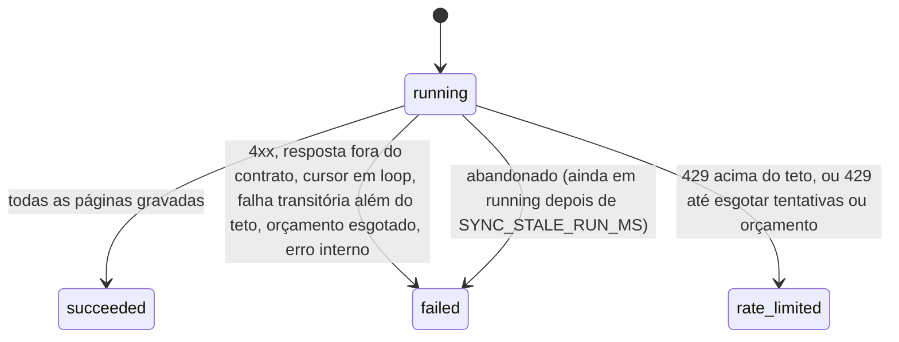

# Métricas das redes do criador

Serviço que recebe uma conexão já autorizada com Instagram, TikTok, YouTube ou X (o token pode ser fictício) e sincroniza views, curtidas e comentários dos posts. Ele aguenta timeout, resposta duplicada e limite de taxa do provedor. Duas sincronizações com janelas sobrepostas não contam o mesmo post duas vezes.

O provedor é simulado: um app Hono separado em `src/fake-provider/`, que fala HTTP e pode responder com timeout, resposta lenta, 5xx, 429 com `Retry-After`, itens duplicados, posts repetidos entre páginas, post fora da janela e cursor em loop.

## Como rodar

Precisa de Node 22.13 ou mais novo. O teste de carga também precisa de Docker.

```bash
npm install
npm run provider   # terminal 1: provedor simulado em http://localhost:3010
npm run dev        # terminal 2: API em http://localhost:3000 (banco em data/metrics.sqlite)
npm test           # unitários + integração (sqlite em memória, relógio controlado)
npm run typecheck
npm run load       # sobe provedor (3112) e API (3102), roda k6 no Docker e verifica as invariantes
```

Configuração da API por variável de ambiente. Tudo passa por um schema zod na subida: valor que não é inteiro positivo (por exemplo `abc`, `0` ou `-1`) impede o processo de subir, porque um teto `NaN` desligaria o limite de tentativas.

| Variável | Padrão | O que faz |
|---|---|---|
| `PORT` | 3000 | porta da API |
| `DB_PATH` | `data/metrics.sqlite` | arquivo do sqlite |
| `PROVIDER_BASE_URL` | `http://localhost:3010` | onde está o provedor |
| `PROVIDER_TIMEOUT_MS` | 5000 | timeout de cada chamada (AbortController) |
| `SYNC_MAX_ATTEMPTS` | 5 | teto de tentativas por página, contando a primeira |
| `SYNC_MAX_TOTAL_ATTEMPTS` | 300 | teto de chamadas ao provedor no sync inteiro (precisa ser pelo menos `SYNC_MAX_PAGES`) |
| `SYNC_BACKOFF_BASE_MS` / `SYNC_BACKOFF_MAX_MS` | 500 / 8000 | backoff exponencial das falhas transitórias |
| `SYNC_MAX_RETRY_AFTER_MS` | 30000 | maior `Retry-After` que o sync aceita esperar |
| `SYNC_MAX_TOTAL_WAIT_MS` | 60000 | soma máxima das esperas de um sync |
| `SYNC_MAX_RATE_LIMIT_BLOCK_MS` | 86400000 | por quanto tempo, no máximo, um 429 bloqueia a conexão |
| `SYNC_STALE_RUN_MS` | 900000 | idade a partir da qual um run em `running` é dado como abandonado |
| `SYNC_MAX_PAGES` | 100 | proteção contra paginação sem fim |

## Onde fica cada coisa

```
src/
  app.ts                  rotas HTTP, middlewares de corpo JSON e mapeamento de erro
  schemas.ts              todos os schemas zod: corpo, query, params, resposta do provedor, env
  sync-service.ts         regra do sync: paginação, retry, 429, orçamentos, gravação idempotente
  domain/retry.ts         funções puras: backoff, parse do Retry-After, decisão de repetir
  provider/types.ts       contrato ProviderClient (a fronteira)
  provider/http-client.ts implementação HTTP do contrato: timeout, classificação de status, parse
  fake-provider/          provedor simulado (app Hono separado) e dados determinísticos
  db.ts                   schema e todo o SQL
  clock.ts                Clock, Sleep e ManualClock para testes
docs/exemplos.md          requests e responses reais
```

A fronteira entre o provedor falso e a regra de negócio é a interface `ProviderClient` em `src/provider/types.ts`. O `SyncService` só conhece esse contrato. O `HttpProviderClient` faz a chamada e devolve um de quatro resultados: `ok`, `transient` (timeout, erro de rede, 5xx, 408), `rate_limited` (429, com o header `Retry-After` cru) ou `permanent` (outros 4xx, JSON fora do contrato). Ele não repete nada. Quem decide se repete, quanto espera e quando desiste é o `SyncService`, usando as funções puras de `domain/retry.ts`.

O provedor simulado não é importado pela API. Nos testes de integração, o cliente HTTP real recebe um `fetch` que aponta para `providerApp.request(...)`. Assim o caminho todo (URL, headers, status, JSON, timeout) é exercitado sem abrir porta. No `npm run dev` e no teste de carga ele roda como servidor separado.

## Modelo de dados

```
connections       (id, creator_id, platform, external_account_id, access_token, rate_limited_until)
                  UNIQUE (platform, external_account_id)
posts             (connection_id, external_post_id) PK, published_at, caption,
                  first_fetched_at, last_fetched_at
metric_snapshots  (connection_id, external_post_id, captured_at) UNIQUE,
                  views, likes, comments, fetched_at, sync_run_id
sync_runs         id, connection_id, janela, status, started_at, finished_at, attempts, pages,
                  items_received, items_out_of_window, snapshots_inserted, snapshots_duplicated,
                  error_code, error_message, retry_at
sync_attempts     uma linha por chamada ao provedor: page, attempt, outcome, http_status,
                  detail, wait_ms, at
```

Estados de um sync:



## Idempotência: quando o mesmo post chega de novo

Cada número que o provedor manda é um snapshot identificado por `(conexão, post externo, captured_at)`. `captured_at` é o instante em que o provedor mediu, e vem na resposta. Essa tripla é `UNIQUE` no banco, e a gravação usa `INSERT ... ON CONFLICT DO NOTHING`. Então a mesma medição só entra uma vez, não importa por onde ela voltou:

- post repetido entre páginas (o simulado sempre repete o último post da página anterior);
- o mesmo item duas vezes na mesma página;
- a mesma janela sincronizada duas vezes;
- janelas que se sobrepõem;
- dois syncs da mesma conexão rodando ao mesmo tempo;
- um retry depois de um timeout em que o provedor tinha respondido.

As datas são normalizadas para ISO UTC com milissegundos antes de virarem chave. Sem isso, `10:00:00Z` e `07:00:00.000-03:00` seriam snapshots diferentes. O mesmo `external_post_id` em duas conexões não se mistura, porque a conexão faz parte da chave.

Quando o provedor mede de novo (outro `captured_at`), entra um snapshot novo e o histórico fica preservado. A métrica atual do post é o snapshot com o maior `captured_at`, e não o último que chegou: se um cache velho do provedor devolver uma medição antiga depois de uma nova, ela vai para o histórico e não substitui a atual. Os totais da conexão e do criador somam só esse snapshot mais recente de cada post (`latestSnapshots` em `src/db.ts`). Somar snapshots do mesmo post nunca acontece.

Se o provedor mandar números diferentes com o mesmo `captured_at`, fica o primeiro que chegou. Para mim, a mesma medição não pode ter dois valores, e eu preferi não deixar um reenvio sobrescrever dado silenciosamente.

Post que o provedor devolve com `published_at` fora da janela pedida é descartado e contado em `items_out_of_window` no run.

Cada página é gravada numa transação (`BEGIN IMMEDIATE`). Se a gravação falha no meio, a página inteira é desfeita. Se a página 2 falha no provedor, o que veio na página 1 fica gravado; como a gravação é idempotente, rodar o sync de novo completa sem duplicar.

### Sync concorrente da mesma conexão

Eu não coloquei lock. Dois syncs da mesma conexão podem rodar juntos, e o resultado final é o mesmo, porque a unicidade está no banco. O custo é gastar chamadas do provedor em dobro nesse caso. Um lock exigiria tratar lock órfão, e na escala do desafio a idempotência já garante que os números saiam certos. O teste `syncs concorrentes da mesma conexão com janelas sobrepostas terminam com um snapshot por post` dispara 10 syncs com `Promise.all`, e a carga faz isso com 40 usuários virtuais em 20 conexões.

## Quando a métrica foi buscada

Cada snapshot tem `captured_at` (quando o provedor mediu) e `fetched_at` (quando nós buscamos), além do `sync_run_id` que o trouxe. O post tem `last_fetched_at`, que avança mesmo quando o snapshot veio repetido, então dá para saber se o número foi confirmado recentemente. `/connections/:id/metrics` e `/creators/:id/metrics` devolvem `last_fetched_at`. Cada execução fica em `sync_runs` (início, fim, status, tentativas, erro), e cada chamada ao provedor fica em `sync_attempts`, com quanto tempo o serviço esperou depois dela.

## Retry e 429

A decisão está em `decideRetry` (`src/domain/retry.ts`):

- Falha transitória (timeout via AbortController, erro de rede, 5xx, 408): repete com backoff exponencial `base * 2^(tentativa-1)`, limitado a `SYNC_BACKOFF_MAX_MS`, até `SYNC_MAX_ATTEMPTS` por página. Depois disso o sync termina `failed` com `provider_unavailable`. Uma resposta que chega depois do timeout é ignorada e não grava nada.
- Erro permanente (401, 403, 404, JSON fora do contrato): não repete. O sync termina `failed` com `provider_rejected`.
- 429: lê o `Retry-After` em segundos ou em HTTP-date e espera exatamente esse prazo. Se o pedido for maior que `SYNC_MAX_RETRY_AFTER_MS`, o sync não espera: termina `rate_limited`, grava `retry_at` e devolve 503 com `Retry-After`. O 429 também conta para o teto de tentativas, inclusive com `Retry-After: 0`. Sem `Retry-After` válido, usa o mesmo backoff das falhas transitórias.
- Depois de um `rate_limited`, a conexão guarda `rate_limited_until`. Até esse instante, um novo sync responde 503 sem chamar o provedor. O bloqueio nunca passa de `SYNC_MAX_RATE_LIMIT_BLOCK_MS` (24 h por padrão), mesmo que o provedor peça anos; o valor original fica no `detail` da tentativa.
- O sync inteiro tem dois orçamentos: `SYNC_MAX_TOTAL_ATTEMPTS` chamadas e `SYNC_MAX_TOTAL_WAIT_MS` de espera somada. Se a próxima espera ou a próxima chamada estouraria um deles, o sync para (`rate_limited` quando o provedor estava em 429, `failed` nos outros casos) com a mensagem dizendo qual orçamento acabou. O teto de páginas e um guarda contra cursor repetido completam a garantia de que o sync sempre termina.

O parse do `Retry-After` é estrito de propósito. Segundos só como inteiro sem sinal (`1.5`, `+5`, `1e3` e `5s` são inválidos). Data só no formato IMF-fixdate (`Thu, 01 Oct 2026 12:00:30 GMT`) e conferida por ida e volta: dia inexistente e dia da semana errado são recusados. Os formatos obsoletos que a RFC ainda aceita (RFC 850 e asctime) também viram "inválido", e aí vale o backoff. Valores enormes viram no máximo um ano, para nunca gerar `Infinity` nem data fora do intervalo do `Date`.

A espera é uma função `Sleep` injetada, e o relógio é um `Clock` injetado. Nos testes, `ManualClock.sleep` não dorme: anota quanto foi pedido e avança o relógio. Por isso os testes afirmam o tempo exato (`expect(h.clock.sleeps).toEqual([3000])`, `finished_at` 3 s depois de `started_at`) e rodam em milissegundos.

Um erro inesperado no meio do sync (banco falhando, por exemplo) fecha o run como `failed`/`internal_error` e responde 500 genérico. Se o processo inteiro morrer, o run fica em `running` até o próximo sync da mesma conexão, que fecha como `failed`/`abandonado` todo run mais velho que `SYNC_STALE_RUN_MS`.

## Validação e limites

Toda entrada passa por um schema zod em `src/schemas.ts`: corpo, query, parâmetros de rota, resposta do provedor e variáveis de ambiente. O provedor simulado também valida as próprias rotas. Campo desconhecido é ignorado. Corpo sem `content-type: application/json` recebe 415, JSON quebrado ou vazio recebe 400, e corpo acima de 16 KB recebe 413. Campo inválido recebe 400 com `details` (caminho e motivo de cada problema). As datas precisam de fuso e passam por conferência de ida e volta (`2026-02-30` é recusado), e as listagens aceitam `limit` de 1 a 200. `external_account_id` é normalizado (sem `@`, minúsculo, sem espaço nas pontas), então `@Ana.Cria` e `ana.cria` são a mesma conexão. Rota ou método inexistente recebe 404 JSON, e erro inesperado recebe 500 JSON sem stack trace.

## Regras do enunciado e onde estão

| Regra | Código | Teste |
|---|---|---|
| Mesmo snapshot não duplica, nem com janela sobreposta | `metric_snapshots` UNIQUE + `ingestPage` em `src/db.ts` | `idempotency.test.ts`: "janelas sobrepostas não contam o mesmo post duas vezes", "a mesma resposta chegando duas vezes não duplica nem soma", "post repetido entre páginas...", "syncs concorrentes..." |
| Total usa a medição mais recente, sem somar | `latestSnapshots` em `src/db.ts` | "nova medição do provedor vira novo snapshot e o total usa só a mais recente, sem somar", "snapshot antigo que chega depois...", `api.test.ts` "somam o snapshot mais recente de cada post em todas as plataformas" |
| Falha transitória tem retry com limite | `decideRetry`, `SyncService.fetchPageWithRetry` | `retry.test.ts`: "503 é repetido com backoff exponencial...", "falha transitória persistente para no teto de tentativas, sem loop infinito", "timeout do provedor é abortado...", "erro 4xx (token revogado) não é repetido", "teto de chamadas do sync inteiro..." |
| 429 espera o Retry-After e respeita o teto | `parseRetryAfterMs`, `decideRetry` | `retry.test.ts`: "429 com Retry-After em segundos espera exatamente esse prazo no relógio controlado", "...HTTP-date...", "Retry-After acima do teto configurado...", "enquanto o retry_at não passa...", "Retry-After 0 não vira loop...", "Retry-After %s termina rate_limited... bloqueia no máximo 24h" |
| Dá para saber quando a métrica foi buscada | `fetched_at`, `last_fetched_at`, `sync_runs`, `sync_attempts` | "cada post mostra captured_at (medição do provedor), fetched_at (nossa busca) e last_fetched_at" |
| Fronteira legível entre provedor falso e regra | `src/provider/types.ts` | todos os testes de integração passam pelo `HttpProviderClient` real |
| Entrada inválida nunca vira 500 nem grava | `src/schemas.ts`, `requireJson` em `src/app.ts` | `payloads-invalidos.test.ts`, `bordas.test.ts` |

## Exemplos

Os exemplos completos, todos copiados de chamadas reais, estão em [`docs/exemplos.md`](docs/exemplos.md). Os dois principais:

```bash
curl -X POST localhost:3102/connections/ac64a167-.../sync -H 'content-type: application/json' \
  -d '{"since":"2026-09-03T00:00:00Z","until":"2026-09-09T00:00:00Z"}'
```

```json
{"sync_run":{"id":"068b984e-...","status":"succeeded","attempts":3,"pages":3,"items_received":24,"items_out_of_window":0,"snapshots_inserted":14,"snapshots_duplicated":10,"...":"..."}}
```

Essa janela se sobrepunha a uma anterior: dos 24 itens, 10 já existiam e não foram gravados de novo.

```
HTTP/1.1 503 Service Unavailable
retry-after: 120
{"error":{"code":"provider_rate_limited","message":"provedor pediu 120000ms de espera, acima do teto de 10000ms"},"retry_at":"2026-10-10T04:18:53.032Z","sync_run":{"status":"rate_limited","attempts":1,"...":"..."}}
```

Rotas: `POST /connections`, `GET /connections/:id`, `POST /connections/:id/sync`, `GET /connections/:id/sync-runs`, `GET /sync-runs/:id`, `GET /connections/:id/posts`, `GET /connections/:id/posts/:postId/snapshots`, `GET /connections/:id/metrics`, `GET /creators/:creatorId/metrics`, `GET /health`.

## Por que essa solução

Um processo Node com sqlite serializa as escritas. Com a unicidade no banco e uma transação por página, isso basta para a ordem de grandeza do desafio: dezenas de conexões, cada uma com algumas páginas por sync, e syncs disparados por agendamento ou por um botão. Redis ou lock distribuído não resolveriam nada que o `UNIQUE` já não resolva, porque o sync não tem efeito colateral externo além de ler o provedor.

O sync roda dentro da requisição HTTP e espera o `Retry-After` ali mesmo, o que deixa o comportamento fácil de ver e de testar. A desvantagem é segurar a requisição durante a espera. Por isso existem o teto por espera, o orçamento total e, acima deles, a devolução do controle com `retry_at`.

Com várias instâncias, eu mudaria nesta ordem:

1. Postgres com as mesmas restrições `UNIQUE` e `INSERT ... ON CONFLICT DO NOTHING`. A idempotência continua igual.
2. Sync como job numa fila (o próprio Postgres serve, com `SELECT ... FOR UPDATE SKIP LOCKED`), com uma linha de lease por conexão para não gastar cota do provedor em syncs duplicados. A espera do 429 vira reagendamento do job para `retry_at`.
3. Cota por token do provedor compartilhada entre instâncias. Só aí um contador central (Redis ou tabela) faria sentido.

## Resultado do teste de carga

`npm run load` sobe o provedor simulado com chaos ligado e semente fixa (`CHAOS_SEED=42`): 10% de 503, 5% de 429 com `Retry-After: 1`, 0,2% de 429 com `Retry-After: 3` acima do teto de 2 s, 2% de timeout, 20% de itens duplicados na página e post repetido entre páginas sempre. O relógio do simulado fica congelado, então cada post tem exatamente uma medição. A API roda com timeout de 1 s, 6 tentativas e backoff de 50 ms a 800 ms. O k6 cria 20 conexões e roda 40 usuários virtuais disparando syncs com janelas aleatórias que quase sempre se sobrepõem (10% das iterações mandam payload inválido, que precisa voltar 4xx), mais 5 lendo métricas, por 30 s.

Depois, `scripts/verify-load.ts` lê o banco e a API e falha se: existir snapshot repetido; algum post tiver mais de um snapshot; algum número gravado divergir do provedor; sobrar sync em `running`; existir conexão além das 20 do setup (um payload inválido teria gravado). Em seguida ele desliga o chaos, faz um sync final de cada conexão e compara os totais de cada conexão e de cada criador com o que o provedor diz.

Resultado real da última execução local (macOS, k6 0.54.0 no Docker):

```
✓ checks.........................: 100.00% 31930 out of 31930
✓ { scenario:reads }...........: avg=2.4ms    med=1.04ms p(90)=3.63ms   p(95)=6.72ms
✓ { scenario:syncs }...........: avg=121.06ms med=2.6ms  p(90)=158.69ms p(95)=1.05s
✓ http_req_failed................: 0.00%   1 out of 12859
  http_reqs......................: 12859   389.458056/s
✓ invalid_payload_rejected_4xx...: 100.00% 1027 out of 1027
  sync_201_succeeded.............: 7518
  sync_502_failed................: 1
  sync_503_rate_limited..........: 1513
✓ sync_success_rate..............: 83.23%  7518 out of 9032
provedor durante a carga: {"200":12578,"429":781,"503":1533,"requests":15183,"duplicate_items":3030,"timeout":291}
sync_runs: [{"status":"failed","n":1,"attempts":6},{"status":"rate_limited","n":31,"attempts":59},{"status":"succeeded","n":7518,"attempts":15118}]
conexões: 20, snapshots durante a carga: 600, depois do sync final: 600 snapshots para 600 posts
verificação ok: nenhum snapshot duplicado, números iguais aos do provedor, totais conferem
```

O p95 de 1,05 s dos syncs vem quase todo da espera de `Retry-After: 1`; a mediana fica em 2,6 ms. Das 1513 respostas 503, 31 vieram de syncs que receberam um 429 acima do teto ou esgotaram as tentativas. As outras foram syncs recusados sem chamar o provedor, porque a conexão ainda estava dentro do `retry_at`. O único 502 foi um sync que pegou 6 falhas transitórias seguidas na mesma página, o que o teto deixa acontecer. 4xx e 503 contam como resposta esperada em `http_req_failed`, e a taxa de sucesso dos syncs tem threshold próprio (`> 0.7`). Rodei a carga cinco vezes com a semente fixa enquanto fazia as últimas mudanças, e a taxa ficou entre 83,2% e 85,9%. A semente repete a sequência de falhas sorteadas, mas a ordem das requisições muda entre execuções, então o número exato também muda um pouco.

## O que ficou de fora

- OAuth real e refresh de token. O token fica em texto puro no sqlite (nunca volta na API); em produção eu cifraria em repouso, com a chave fora do banco.
- Mapeamento dos campos de cada API real, que usam nomes e formatos próprios. O simulado é um provedor genérico parametrizado pela plataforma, e esse mapeamento caberia num cliente HTTP por plataforma.
- Agendamento automático de sync. Hoje alguém (ou um cron) chama `POST /connections/:id/sync`.
- Jitter no backoff. Deixei determinístico para os testes afirmarem o tempo exato; em produção eu adicionaria jitter com um gerador injetado.
- Migração de schema. O banco é criado do zero; um `data/metrics.sqlite` de uma versão anterior precisa ser apagado.

## O que eu faria diferente com mais tempo

- Rodar o sync como job, com lease por conexão, e devolver `202` com o id da execução.
- Registrar conflito quando o mesmo `captured_at` chega com números diferentes.
- Quando o provedor não manda `captured_at`, usar um hash do conteúdo como chave do snapshot. Hoje um item sem `captured_at` torna a página inválida.
- Respeitar headers de cota que algumas APIs mandam antes do 429 (`X-RateLimit-Remaining`) para desacelerar antes de ser barrado.

## Uso de IA

O código, os testes e este README foram produzidos com Claude Code (Claude Opus) a partir do enunciado do desafio.

O que eu revisei: as regras de idempotência e de retry, os testes de integração (para conferir que cada critério do enunciado está coberto) e os exemplos do README contra as respostas reais da API. Também rodei `npm test`, `npm run typecheck` e `npm run load` localmente.
